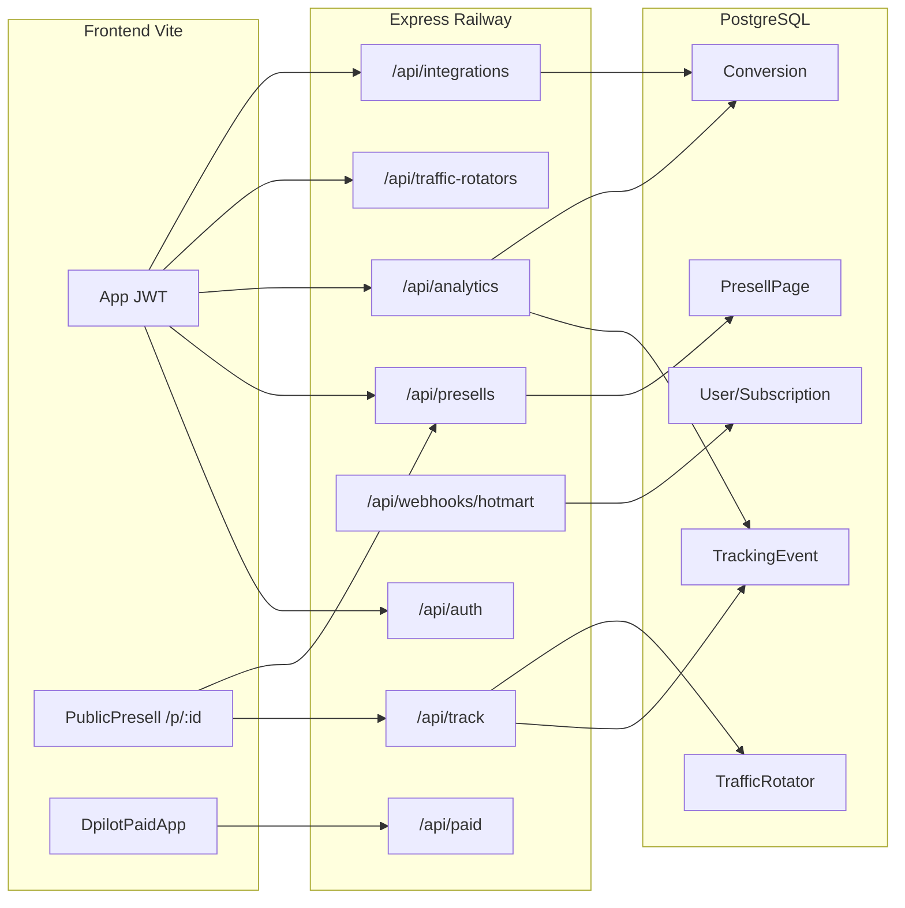

# Auditoria Master End-to-End — DClickora

**Início:** 2026-10-31  
**Branch / HEAD:** `main` @ `e639a6f` (estado no arranque da auditoria)  
**Regra:** não inventar resultados; distinguir **inspeccionado no código**, **testado nesta sessão**, **histórico de docs/transcripts**, **bloqueado**.

Legenda de estado (secção 19 do briefing):

| Estado | Significado |
|--------|-------------|
| VALIDADO COM EVIDÊNCIA | Teste executado nesta sessão com prova |
| FALHOU | Teste executado; comportamento incorrecto |
| BLOQUEADO POR CREDENCIAIS OU ACÇÃO HUMANA | Código/config existem; falta secret, consentimento ou gateway |
| NÃO TESTADO | Ainda não corrido nesta auditoria |

---

## FASE A — Inventário e mapa da arquitectura

**Estado da fase:** concluída (inventário estático + leitura de docs).  
**Testes runtime nesta fase:** nenhum (API local down; Postgres Docker indisponível; `.env` aponta Railway — mutações proibidas).

### A.1 Documentação consultada

| Documento | Presente em `docs/`? | Notas |
|-----------|----------------------|-------|
| `INDICE_DOCUMENTACAO_DCLICKORA.md` | Sim | Mapa Etapas 1–7 (hardening 2026-10-30) |
| `ARQUITETURA_DCLICKORA.md` | Sim | Alinhado com `server.ts` |
| `GUIA_DESENVOLVEDOR_DCLICKORA.md` | Sim | Instalação, módulos, testes |
| `SEGURANCA_E_ISOLAMENTO.md` | Sim | IDOR local; ENCRYPTION_KEY |
| `RELATORIO_ACEITACAO_FINAL_DCLICKORA.md` | Sim | Unit/paid/load/IDOR locais; produção condicional |
| `AUDITORIA_EMPRESARIAL_DCLICKORA.md` | Sim | Diagnóstico P0–P3 |
| `FLUXOS_FUNCIONAIS_DCLICKORA.md` | Sim | Muitos fluxos “parcial / não testado E2E” |
| `TRACKING-SLO.md`, `METRICAS-HONESTAS.md` | Sim | Contratos honestos de métricas |
| **`FASE7_VALIDACAO_OPERACIONAL_DCLICKORA.md`** | **Não** | Existiu em sessão anterior (transcript); **não está no git** |
| **`FASE8_FECHO_LACUNAS_OPERACIONAIS.md`** | **Não** | Idem; scripts `fase7-*` / `fase8-*` também ausentes do tree |
| `PREPARACAO_PRODUCAO_*`, `OPERACAO_WORKER_*`, `DESEMPENHO_*` | Não no tree actual | Referenciados em transcripts F7/F8 |

**Implicação:** o histórico operacional F7/F8 é **referência de transcript**, não artefactos versionados. Esta auditoria **não** trata F7/F8 como garantia do estado actual sem revalidação.

### A.2 Ambiente local (arranque da auditoria)

| Item | Observação |
|------|------------|
| `backend/.env` `DATABASE_URL` | Aponta a **Railway** (`*.rlwy.net`) — **risco A6**; scripts mutantes devem ser recusados |
| Docker Compose | Indisponível nesta máquina/sessão |
| API `:3001` / Vite `:8080` | Down |
| Redis | Não verificado (opcional) |

### A.3 Stack e entrada

```
Browser (Vercel / dclickora.com)
    │  HTTPS + Bearer JWT (app) | público (track / public)
    ▼
Express  backend/src/server.ts
    ├── /api/auth, /api/enterprise
    ├── /api/presells, /api/campaigns, /api/keyword-researches, /api/lessons
    ├── /api/analytics, /api/plans, /api/admin
    ├── /api/track          ← público + rate-limit (memória ou Redis)
    ├── /api/webhooks       ← Hotmart (assinatura SaaS)
    ├── /api/integrations   ← postback afiliado + Google/Meta/TikTok CAPI settings
    ├── /api/custom-domain, /api/traffic-rotators, /api/workspaces
    ├── /api/paid (+ OAuth callbacks públicos)
    └── /api/public
         │
         ▼
    Prisma → PostgreSQL
    (opcional) Redis — rate-limit /track
```

Tenant: `userId` do dono + ALS (`tenantPrisma.ts` / `USER_ID_MODELS`). Paid ads: `systemPrisma` + ownership manual.

### A.4 Contagens do repositório (inventário)

| Camada | Quantidade |
|--------|------------|
| Modelos Prisma | 47 |
| Ficheiros de rotas API | 18 |
| Controllers | 23 |
| Páginas React (`pages/**/*.tsx`) | 79 |
| Playwright specs | 10 |
| Scripts `backend/scripts/e2e-*.ts` | 29 |
| Testes unitários backend `*.test.ts` | 78 |

### A.5 Frontend — rotas de produto (reais)

**Públicas:** `/`, `/auth`, `/plans`, `/p/:id`, legais, intent landing.

**App (JWT):**

| Domínio | Rotas principais |
|---------|------------------|
| Presells | `/presells`, `/presells/nova`, `/presell/paginas-criadas`, `/presell/templates/*` |
| Campanhas afiliado | `/campanhas`, `/campanhas/:id` |
| Resultados / métricas | `/resultados`, `/resultados/funil`, `/resultados/relatorios/:tab` |
| Integrações | `/integracoes`, `/integracoes/postback`, `/integracoes/google-ads`, `/integracoes/pixels`, `/integracoes/automizer` |
| Tracking ops | `/tracking/rotadores`, `/tracking/tools/*`, `/tracking/blacklist`, `/tracking/url-builder`, `/tracking/logs` |
| Paid ads | `/tracking/dpilot/*` (lazy `DpilotPaidApp`) |
| Settings / admin | `/configuracoes`, `/conta`, `/admin/:tab`, `/aulas`, `/palavras-chave` |

Muitas rotas `/tracking/*` antigas são **Navigate** para o hub novo (legado preservado).

### A.6 Tipos de presell — valores reais no código

Campo DB: `PresellPage.type` (String). Catálogo UI: `frontend/src/lib/presellTypeOptions.ts` + `builder`.

| ID código | Nome produto | Família |
|-----------|--------------|---------|
| `cookies` | Cookies (consentimento) | Gate |
| `fantasma` | Fantasma (redirect 1.º gesto) | Gate / bridge |
| `tsl` | TSL | Editorial |
| `dtc` | DTC | Editorial |
| `review` | Review / análise | Editorial |
| `desconto` | Desconto + urgência | Editorial |
| `vsl` | VSL | Vídeo |
| `vsl_tsl` | VSL + TSL | Híbrida vídeo+texto |
| `sexo`, `idade`, `idade_sexo`, `idade_pais`, `sexo_pais`, `grupo_homem`, `grupo_mulher`, `pais`, `captcha`, `modelos` | Qualificação | Gates |
| `builder` | Manual (editor visual) | Page-builder |

**Correspondência com o briefing do utilizador:**

| Briefing | Código real |
|----------|-------------|
| Presell manual | `builder` (+ editor em `/presell/paginas-criadas`) |
| Presell automática | Wizard + `POST /api/presells/import-from-url` → espelho HTML / tipos acima |
| Presell com cookies | tipo `cookies` (não é o único que usa cookies de ads) |
| VSL | `vsl` |
| TSL | `tsl` |
| Híbrida | `vsl_tsl` (+ espelho + overlays em vários tipos) |

Não inventar tipos fora desta lista. Comportamento público: `PublicPresell` + `presellTypeMeta.ts`.

**Addendum inventário paralelo (código):**

- Create canónico: `createSchema` Zod em `presell.controller.ts` — **19** strings (18 do combobox + `builder`).
- `builder` **fora** do combobox; criado no editor `/presell/builder`; publish instantâneo (`isInstantPublishPresellType`).
- “Automática” / “híbrida” **não** são valores de `type` — são fluxo `import-from-url` + `importMirrorSrcDoc` / `importMode` (`mirror|template|incomplete`).
- Nicho white: combobox restringe a `cookies|tsl|dtc|review|desconto|vsl|vsl_tsl`; `coercePresellTypeForNiche`.
- Gap: `PresellCreator` (`/presell/templates/*`) é **legado/stub** — `handleSave` só toast, **não** persiste na API.
- Gap: `PUT` aceita `type` string com coerce de nicho; enum estrito está no **create**.

### A.7 Tracking — endpoints e fluxo de dados

**Público (`/api/track`):**

| Método | Path | Função |
|--------|------|--------|
| GET | `/r/:presellId` (+ `/*` subids) | Redirect oferta + registo click |
| GET | `/rot/:rotatorId` (+ `/*`) | Rotador → destino |
| GET | `/pixel/:presellId.gif` | Impression / visita |
| GET | `/funnel/:step(.gif)` | Funnel pixel (token) |
| GET | `/v2/clickora.min.js` | Embed pageview |
| POST | `/click`, `/impression`, `/event` | Eventos JSON |
| POST | `/conversions/csv` | Import CSV |
| POST | `/postback/google-ads`, `/postback/microsoft-ads` | Postbacks ads |

**Autenticado:** templates/audit postback, lookup gclid/IP.

**Fluxo canónico (código):**

```
Visita lander (/p/:id ou domínio custom)
  → pixel GET /track/pixel/:id.gif  e/ou embed pageview  → TrackingEvent(impression|pageview)
Clique CTA / mirror
  → GET /track/r/:presellId?…  → TrackingEvent(click) + 302 hoplink
    → appendClickIdToAffiliateUrl (subid/cid/src/… por rede)
Rede afiliada
  → GET|POST /api/integrations/affiliate-webhook?token=…
    → parseAffiliatePostback → Conversion (+ PostbackLog)
Painel
  → /api/analytics/* → UI Resultados
```

**Identificadores (captura — evidência de código em track/voluum/outbound):**

| ID | Papel |
|----|--------|
| UUID do `TrackingEvent` | Click interno Clickora; ecoado como `clickora_click_id` / params de rede |
| `gclid`, `gbraid`, `wbraid` | Google Ads (query → metadata) |
| `fbclid`, cookie `_fbp` | Meta (captura) |
| `fbc` | **Não** lido do browser; **sintetizado** no envio CAPI: `fb.1.{ts}.{fbclid}` |
| `ttclid`, cookie `_ttp` | TikTok |
| `msclkid` | Microsoft (postback dedicado) |
| `parent_click_id` | Liga CTA da lander ao clique do rotador |
| `cost`, `externalid`, `clickid`, `cid`, `var1`–`var10` | Estilo Voluum (metadata; ≠ UUID Clickora) |
| Path `/r\|rot/:id/fonte/campanha/criativo` | → `sub1`/`sub2`/`sub3` no relatório |

**Envio para plataformas de ads (distinto da captura):** após `Conversion` **attributed** — `syncConversionToGoogleAds` / Meta CAPI / TikTok Events (`void` fire-and-forget). Unattributed **não** dispara sync.

**Dual store (risco de interpretação):**

| Canal | Modelo | Alimenta CAPI/Offline? |
|-------|--------|------------------------|
| Affiliate webhook / CSV | `Conversion` | Sim (se attributed) |
| `POST /track/postback/google-ads` \| `microsoft-ads` | `TrackingEvent(conversion)` | Google directo sem linha `Conversion`; **não** pipeline CAPI/TikTok |

**Fragilidades inventariadas (código, não testadas runtime):** MaxWeb preferir `subid2`; Digistore/Hotmart UUID em `sid1`/`sck` se `cid`/`src` ocupados; macros `{gclid}` filtradas → `paid_untracked` / `skipped_no_*`; POST `/track/event` rejeita `conversion`/`sale` públicos.

### A.8 Rotadores — modalidades reais

Enum `TrafficRotatorMode`: **`random` | `weighted` | `sequential` | `fill_order`**.

| Modalidade | Comportamento (código) |
|------------|------------------------|
| `weighted` | Pesos > 0; A/B; `promote-winner` força 100/0 |
| `random` | Uniforme entre elegíveis |
| `sequential` | Round-robin (`sequenceCursor`) |
| `fill_order` | Esgota `maxClicks` do 1.º braço, depois seguinte |
| Sticky session | **Não implementado** (só UI “sticky” CSS/widgets) |
| Regras | Geo/device por braço + `rulesPolicy` JSON (`routingRules`) |
| Fallback | `backupUrl` + health probe opcional |

CRUD: `/api/traffic-rotators` (+ `ab-stats`, `promote-winner`). Público: `/api/track/rot/:rotatorId`. Contexto: `contextPresellId` obrigatório. Também: `access_code`, `rules_policy` (block/redirect/use_backup), health failover com `backup_url`.

**Cadeia URL típica (código):**

```
Ads → GET /api/track/rot/:id  → 302 braço (forwardAdQueryToUrl + clickora_click_id)
   → lander /p/:id?clickora_click_id=…
   → CTA GET /api/track/r/:id?to=hoplink&parent_click_id=…
   → 302 oferta (appendClickIdToAffiliateUrl; sem forwardAdQueryToUrl no /r/)
```

**Segurança redirects:**

| Hop | Guard |
|-----|--------|
| `/track/r/` | `isRedirectToAllowedOffer` (open-redirect) — host/path vs hoplink configurado |
| `/track/rot/` | Destino da BD (braço/backup/policy) — **sem** allowlist de hoplink; intencional |
| Probe saúde rotador | SSRF: skip localhost/privado |

Docs de produto **não** inventariam os 4 modos; verdade = schema + UI `Rotadores.tsx` + `trafficRotator.service.ts`.

### A.9 Postbacks afiliado — plataformas no código

Parsers em `backend/src/lib/affiliatePlatforms/parseAffiliatePostback.ts` + outbound em `outboundClickParams.ts`:

Endpoint comum: `GET|POST /api/integrations/affiliate-webhook?token=…` (+ `platform` opcional). Sempre ecoa também `clickora_click_id` no outbound quando aplicável.

| Plataforma | Outbound | Click ID no postback (prioridade UUID) | Order / tx |
|------------|----------|----------------------------------------|------------|
| Digistore24 | `cid`, `sid1` | `clickora_click_id`, `sid1`, `cid` | `transaction_id` / `order_id` |
| BuyGoods | `subid`, `subid2` | `clickora_click_id`, `subid2`, `subid`… | `ORDERID` / `orderid` |
| MaxWeb | `subid`, `subid2` | Preferir **`subid2`** (`subid` pode ser path id) | idem |
| SmartAdv | `sub3` | `clickora_click_id`, `sub3`, `sub5`, `cid` | `transaction_id` |
| Hotmart (afiliado) | `src`, `sck` | flat ou `data.purchase.origin.{src,sck}` | `data.purchase.transaction` |
| ClickBank | `tid` | `tid` / `trackingId`… | `receipt` |
| WarriorPlus | `tid` | `WP_TID`… | `WP_SALEID` |
| JVZoo | `tid` | `tid` / `ctid` | `ctransreceipt` |
| Genérico | `subid`, `subid1`, `subid2` | `parseGeneric` | varia |

**Hotmart webhook `/api/webhooks/hotmart`:** activação de **assinatura SaaS** (produto DClickora), não confundir com postback de afiliado Hotmart no webhook de integrações. ClickBank cifrado sem secret → ignore; JVZoo sem `cverify` válido → rejected.

### A.10 Dual stack Google Ads

1. **Afiliado / conversões offline / insights:** `/api/integrations/google-ads` + `modules/googleAds`  
2. **Paid campaign creation (Dpiloto):** `/api/paid` + `paid/google-ads.*`  

OAuth e tabelas **separadas** (documentado em arquitectura).

### A.11 Base de dados — entidades críticas

`User`, `Workspace*`, `PresellPage` + compliance jobs/audits/decisions, `AffiliateCampaign`, `TrackingEvent`, `Conversion`, `PostbackLog`, `TrafficRotator` + `TrafficRotatorArm`, `CustomDomain`, `BlacklistedIp` / `WhitelistedIp`, `ApiKey`, `AdPlatformCostDaily`, família `PaidAds*`, `Plan` / `Subscription`, branding, academy, keyword research.

Unicidade conversões: `@@unique([userId, externalOrderId])`. Atribuição: `clickId` opcional; `attribution` attributed|unattributed.

### A.12 Divergências docs ↔ código ↔ ambiente (inventário)

| # | Divergência | Severidade inventário |
|---|-------------|----------------------|
| D1 | Docs FASE7/FASE8 + scripts ausentes do git | P1 documentação / rastreabilidade |
| D2 | `DATABASE_URL` local → Railway | P0 ops se alguém correr mutações |
| D3 | `FLUXOS_FUNCIONAIS` ainda marca muitos E2E “não testados”; relatório Etapa 7 marca load/IDOR locais — estados misturados no tempo | P2 docs |
| D4 | Briefing fala “presell híbrida” genérica; código tem `vsl_tsl` + overlays | Clarificação (não bug) |
| D5 | Sticky routing esperado em alguns produtos de tracking; **não existe** no rotador | Expectativa vs produto |
| D6 | Transcript F8 vs tree: no tree actual existem `tokenSecrets.ts` + redacção `api-mappers` (alinhado ao programa Etapas 2–5) | Código actual OK vs transcript intermédio |
| D7 | `PresellCreator` templates stub sem API | P2 UX / dívida |
| D8 | `/r/` não faz `forwardAdQueryToUrl`; ads IDs dependem de merge FE + metadata/parent | P1 a revalidar em FASE E |
| D9 | Dual store conversões track-postback vs `Conversion` | P1 relatórios / atribuição ads |
| D10 | Docs arquitectura não listam os 4 modos de rotador | P3 docs |

### A.13 Fluxos historicamente validados (não reexecutados nesta fase)

Fonte: `RELATORIO_ACEITACAO_FINAL_*` + transcripts F7/F8 (não versionados).

| Fluxo | Fonte | Estado para **esta** auditoria |
|-------|-------|--------------------------------|
| Unitários backend / paid / tsc / frontend build | Relatório Etapa 7 | NÃO TESTADO (ainda) |
| IDOR suite local | Etapa 5/7 | NÃO TESTADO (ainda) |
| Load 20 VUs local | Etapa 7 | NÃO TESTADO (ainda) |
| Lander/pixel/redirect/postback Google em produção | Transcript F7/F8 | NÃO TESTADO nesta sessão — **revalidar** |
| Restore backup isolado | Transcript F8 | NÃO TESTADO nesta sessão |
| Hotmart pagamento real E2E | F8 | BLOQUEADO POR CREDENCIAIS OU ACÇÃO HUMANA |
| OAuth Ads consent completo | F8 | BLOQUEADO POR CREDENCIAIS OU ACÇÃO HUMANA |

### A.14 Diagrama de arquitectura real (resumo)



### A.15 Riscos para fases seguintes

1. **Não usar** o `.env` actual contra Railway em testes mutantes.  
2. Subir Postgres local (`:5434` ou efémero) + API dedicada antes de FASE B–I.  
3. Restaurar ou recriar docs FASE7/FASE8 a partir do transcript **como histórico**, sem os tratar como prova actual.  
4. Tipos de presell: cobrir catálogo real (não só 6 nomes do briefing).  
5. Separar sempre: captura de click IDs ads ≠ envio CAPI/Events/Offline ≠ OAuth Paid publish.

### A.16 O que foi inspeccionado vs testado (fecho FASE A)

| | |
|--|--|
| **Inspeccionado** | Estrutura repo, schema Prisma, rotas server, track/presell/rotator/integrations/webhook/public/analytics, catálogo tipos presell, parsers afiliado, outbound params, frontend App routes, docs Etapas 1–7, transcripts F7/F8; inventários paralelos [tipos de presell](9ca5eb77-67e8-4100-a31a-f237e48ab20c), [tracking/postbacks](30e38ab9-f5c4-47b2-afc2-c89b026a1f3a), [rotadores/URLs](d9697d74-b010-40a4-9463-ee38c08306ce) |
| **Testado runtime** | Nada (serviços locais down; produção não atacada) |
| **Evidências** | Paths e enums citados acima; listagens `docs/`, `schema.prisma`, `server.ts`, `presellTypeOptions.ts` |
| **Falhas encontradas** | D1 (docs F7/F8 ausentes); D2 (DATABASE_URL Railway); ambiente local inoperante |
| **Correcções necessárias agora** | Ambiente local isolado antes de testes; **não** alterar produto na FASE A |
| **Próxima fase** | **FASE B — Auditoria dos tipos de presell** (código + testes controlados em BD local) |

---

## Ambiente de teste efémero (pré-FASE B)

| Campo | Valor |
|-------|--------|
| Host | `127.0.0.1` |
| Porta | `55436` |
| Base de dados | `clickora_audit` |
| Bind | apenas `127.0.0.1` |
| Contacto Railway | **false** |
| Ficheiro env | `backend/.env.audit-fase-b` (não substitui `backend/.env`) |
| `backend/.env` | **intocado** — continua a apontar Railway (não usado nestes testes) |
| API de teste | `http://127.0.0.1:3011` |
| Dados | `pg_data` em `.audit-fase-b-pg/` (gitignored) |

Segurança: `assertLocalDatabaseForMutations` + rejeição de hosts `rlwy`/`railway` antes de migrate/seed/mutações.

---

## Investigações obrigatórias (antes da FASE B)

### 1. Os 19 tipos — implementação funcional

| Tipo | UI wizard | Runtime `PublicPresell` | Publish | Tracking API (FASE B) |
|------|-----------|-------------------------|---------|------------------------|
| 18 tipos do combobox | Sim | Sim (`presellTypeMeta`) | Compliance (exceto builder) | Ver tabela FASE B |
| `builder` | Não (editor `/presell/builder`) | Sim (`pageDocument`) | Instantâneo | Ver tabela FASE B |

Todos os 19 têm ramo de comportamento no código público. Gates demográficos / cookies / fantasma / vídeo dependem de UI no browser — **não** cobertos pelo script HTTP desta fase.

### 2. `PresellCreator` (stub)

- Rota: `/presell/templates/:tab` → `PresellCreator.tsx`.
- `handleSave` só faz `toast.success` — **não** chama API / Prisma.
- Fluxo real de manual: `PresellManualBuilderPage` (`type: builder`).
- **Causa:** UI legado deixada montada.  
- **Impacto (D7):** utilizador pode “salvar” sem criar página — confusão operacional P2.

### 3. Divergências D7–D10

| ID | Causa | Impacto |
|----|-------|---------|
| **D7** | `PresellCreator` sem persistência | Falso positivo de sucesso na UI; páginas não criadas |
| **D8** | `/r/` não faz `forwardAdQueryToUrl`; ads IDs vão em metadata + merge FE de sub1/sub2 | Atribuição Google/Meta no *hoplink* depende do FE; hop rotador sim faz forward |
| **D9** | Postbacks `/track/postback/google-ads\|microsoft-ads` → `TrackingEvent(conversion)` sem linha `Conversion` | Relatório de vendas / CAPI Meta-TikTok **não** vê essas conversões |
| **D10** | Docs de arquitectura não listam modos do rotador | Onboarding de media buyers incompleto (P3) |

### 4. `fbc` sintetizado + dual store

- Captura: `fbclid` + cookie `_fbp`. **`fbc` do browser não é lido.**
- Envio Meta CAPI: `fbc = fb.1.{ts}.{fbclid}` em `metaCapi.service.ts`.
- **Risco:** dedupe browser/server Meta pode degradar se o pixel gerou outro `fbc`; atribuição CAPI ainda exige `fbclid`.
- Dual store: vendas afiliado → `Conversion`; postbacks ads directos no `/track` → só `TrackingEvent`. **Pode parecer “conversão no track” sem aparecer em Resultados/vendas.**

### 5. Open redirect em `/r/`

- **Não era um open redirect aberto:** `isRedirectToAllowedOffer` já bloqueava host/path/query base.
- **Lacunas endurecidas nesta sessão:** porta diferente (`:444`), userinfo (`user@host`), oferta configurada vazia.
- Evidência FASE B: `to=https://evil.example/phish` → sem Location para evil (HTTP 403 página segura).
- Ficheiros: `trackOfferRedirectGuard.ts` + testes (17 pass com destinationProbe).

### Correcção P1 adicional (compliance probe)

- **Bug:** corpo HTML grande (`PresellImportBlockedError` “tamanho máximo”) era mapeado para `errorCode: ssrf_blocked` → falsos FAIL DT/PS (ex.: Wikipedia).
- **Fix:** `destinationProbe.ts` — se body too large e status 2xx/3xx → `ok: true` + `body_too_large` (não SSRF).

---

## FASE B — Auditoria real dos tipos de presell

**Data:** 2026-10-31  
**Ambiente:** API `127.0.0.1:3011` + Postgres `127.0.0.1:55436/clickora_audit`  
**Script:** `backend/scripts/audit-fase-b-presell-types.ts`  
**Conta:** seed local `danielclickora1@gmail.com` (BD audit apenas)

### Âmbito do teste executado

Por tipo: **CRIAR → EDITAR → GUARDAR → GET → PUBLICAR → GET público → PIXEL visita → REDIRECT clique → `clickora_click_id` na Location → bloqueio open-redirect.**

**Fora de âmbito nesta fase (NÃO TESTADO em browser):** gestos fantasma, modais cookies, formulários idade/sexo/captcha, play de vídeo VSL, espelho HTML importado, Playwright visual.

### Tabela consolidada

| Tipo | Implementação | Estado FASE B (HTTP) | Pronto profissional?* |
|------|---------------|----------------------|------------------------|
| cookies | Gate cookies + tracking | VALIDADO COM EVIDÊNCIA | Condicional (UI gate NÃO TESTADO) |
| fantasma | Redirect 1.º gesto | VALIDADO COM EVIDÊNCIA | Condicional (gesto NÃO TESTADO) |
| tsl | Editorial / mirror chrome | VALIDADO COM EVIDÊNCIA | Sim (path API/tracking) |
| dtc | DTC / mirror chrome | VALIDADO COM EVIDÊNCIA | Sim (path API/tracking) |
| review | Review / mirror chrome | VALIDADO COM EVIDÊNCIA | Sim (path API/tracking) |
| desconto | Overlay urgência | VALIDADO COM EVIDÊNCIA | Condicional (overlay UI NÃO TESTADO) |
| vsl | Vídeo | VALIDADO COM EVIDÊNCIA | Condicional (player NÃO TESTADO) |
| vsl_tsl | Vídeo + carta | VALIDADO COM EVIDÊNCIA | Condicional (player NÃO TESTADO) |
| sexo | Gate | VALIDADO COM EVIDÊNCIA | Condicional (form NÃO TESTADO) |
| idade | Gate | VALIDADO COM EVIDÊNCIA | Condicional (form NÃO TESTADO) |
| idade_sexo | Gate composto | VALIDADO COM EVIDÊNCIA | Condicional |
| idade_pais | Gate composto | VALIDADO COM EVIDÊNCIA | Condicional |
| sexo_pais | Gate composto | VALIDADO COM EVIDÊNCIA | Condicional |
| grupo_homem | Gate | VALIDADO COM EVIDÊNCIA | Condicional |
| grupo_mulher | Gate | VALIDADO COM EVIDÊNCIA | Condicional |
| pais | Gate | VALIDADO COM EVIDÊNCIA | Condicional |
| captcha | Gate | VALIDADO COM EVIDÊNCIA | Condicional |
| modelos | Gate | VALIDADO COM EVIDÊNCIA | Condicional |
| builder | Editor visual | VALIDADO COM EVIDÊNCIA | Sim (path API/tracking); não usar `PresellCreator` stub |

\*“Pronto profissional” = criar/publicar/visitar/clicar/redirect/ID preservado **provados**. Interacções só-browser ficam para regressão Playwright (FASE I).

### Resumo

| Métrica | Valor |
|---------|-------|
| VALIDADO COM EVIDÊNCIA | **19 / 19** |
| FALHOU | 0 |
| Evidência típica | `302` + `clickora_click_id` UUID + host `example.com`; evil `to` bloqueado |
| Resultados JSON | `.audit-fase-b-pg/fase-b-results.clean.json` (local, não commit) |

### Achados durante FASE B

1. **Publish PUT devolve HTTP 200 com `compliance_blocked: true` e `status: draft`** — fácil de interpretar mal como “publicado”. O FE (`publishPresellFlow`) já trata `compliance_blocked`; clientes API crus podem falhar. **P2 UX/API honesty.**
2. Limite de plano 25 páginas esgotou-se após corridas — mitigado só na BD audit (`max_presell_pages=500`).
3. Probe SSRF falso positivo em landers grandes — **corrigido**.

### Ficheiros alterados (correcções prioritárias)

| Ficheiro | Alteração |
|----------|-----------|
| `backend/src/lib/trackOfferRedirectGuard.ts` | Porta + userinfo |
| `backend/src/lib/trackOfferRedirectGuard.test.ts` | Novos casos |
| `backend/src/compliance/destinationProbe.ts` | `body_too_large` ≠ SSRF |
| `backend/src/compliance/destinationProbe.test.ts` | Wikipedia / large body |
| `backend/src/compliance/types.ts` | `errorCode: body_too_large` |
| `backend/scripts/audit-fase-b-presell-types.ts` | Script FASE B |
| `backend/.env.audit-fase-b` | Env isolado (gitignored via `.env.*`) |

### Próxima fase

**FASE C — Tracking e atribuição** (concluída abaixo).

---

## FASE C — Tracking e atribuição

**Data:** 2026-10-31  
**Ambiente:** `127.0.0.1:3011` + `127.0.0.1:55436/clickora_audit`  
**Script:** `backend/scripts/audit-fase-c-tracking.ts`  
**Railway:** não usado (`backend/.env` intocado)

### Matriz

| ID | Teste | Resultado |
|----|-------|-----------|
| C1 | Visita (pixel) **sem** clique → `impression` | VALIDADO COM EVIDÊNCIA |
| C2 | `POST /track/event` pageview | VALIDADO COM EVIDÊNCIA |
| C3 | `POST` conversion público bloqueado (403) | VALIDADO COM EVIDÊNCIA |
| C4 | Redirect grava gclid/fbclid/ttclid/gbraid/wbraid + `clickora_click_id` | VALIDADO COM EVIDÊNCIA |
| C5 | Macro `{gclid}` filtrada (não gravada) | VALIDADO COM EVIDÊNCIA |
| C6 | Postback BuyGoods → `Conversion` attributed ao click | VALIDADO COM EVIDÊNCIA |
| C7 | ORDERID duplicado → 1 linha | VALIDADO COM EVIDÊNCIA |
| C8 | Token postback inválido → 401 | VALIDADO COM EVIDÊNCIA |
| C9 | Venda sem click ID → unattributed | VALIDADO COM EVIDÊNCIA |
| C10 | Dual store: Google Ads postback → `TrackingEvent(conversion)` sem nova `Conversion` | VALIDADO COM EVIDÊNCIA |
| C11 | Analytics dashboard 200 | VALIDADO COM EVIDÊNCIA |
| C12 | `parent_click_id` herda gclid do clique pai | VALIDADO COM EVIDÊNCIA (após fix) |

**Resumo:** 12/12 VALIDADO COM EVIDÊNCIA.

### Bug P1 encontrado e corrigido

**Sintoma:** com `parent_click_id` apontando para um clique pai **sem** `rotator_id` no metadata, o filho **não** herdava `gclid`/`fbclid`/….

**Causa:** `fillMissingAdClickIds` só corria quando `rotatorMetaFromParentClick` tinha sucesso (exige `rotator_id`).

**Fix:** em `track.controller.ts` redirect — se o pai for do mesmo tenant, herdar ads IDs sempre; gravar `parent_click_id`; manter campos `rotator_*` só quando aplicável.

**Ficheiros:** `backend/src/controllers/track.controller.ts`, `backend/src/lib/rotatorParentAttribution.test.ts`.

### Cadeia comprovada (evidência)

```
VISITA (pixel) → TrackingEvent(impression) + gclid
CLICK (/r/) → TrackingEvent(click) + ads IDs + clickora_click_id no hoplink
POSTBACK (affiliate-webhook) → Conversion(attributed, clickId, amount)
DUPLICADO → 1 Conversion
SEM click ID → Conversion(unattributed)
GOOGLE /track/postback → TrackingEvent(conversion) [dual store]
```

### Limitações / NÃO TESTADO nesta fase

- Browser real com bloqueadores / Safari ITP  
- Meta CAPI / TikTok Events **envio** (só captura + dual store Google postback)  
- Postbacks Digistore/Hotmart/ClickBank payloads nativos (BuyGoods S2S coberto)  
- Rotador hop real `/track/rot` (FASE D)

### Próxima fase

**FASE D — Rotadores** (pesos, preservação de params, A/B, fallback).

---

## FASE D — Rotadores

**Data:** 2026-10-31  
**Ambiente:** `127.0.0.1:3011` + `127.0.0.1:55436/clickora_audit`  
**Script:** `backend/scripts/audit-fase-d-rotators.ts`  
**Railway:** não usado (`backend/.env` intocado)

### Matriz

| ID | Teste | Resultado |
|----|-------|-----------|
| D1 | `weighted` 70/30 distribuição (n=50) | VALIDADO COM EVIDÊNCIA |
| D2 | `sequential` round-robin A→B→C×2 | VALIDADO COM EVIDÊNCIA |
| D3 | `fill_order` esgota `max_clicks` do 1.º braço | VALIDADO COM EVIDÊNCIA |
| D4 | `random` ambos braços (n=40) | VALIDADO COM EVIDÊNCIA |
| D5 | Preservação gclid/fbclid/ttclid/utm + metadata | VALIDADO COM EVIDÊNCIA |
| D6 | `backup_url` após esgotar braço | VALIDADO COM EVIDÊNCIA |
| D7 | `access_code` 403 sem código / 302 com código | VALIDADO COM EVIDÊNCIA |
| D8 | `rules_policy` redirect força destino | VALIDADO COM EVIDÊNCIA |
| D9 | `device_rule=mobile` → backup no desktop | VALIDADO COM EVIDÊNCIA |
| D10 | `ab-stats` + `promote-winner` endpoint | VALIDADO COM EVIDÊNCIA |
| D11 | Sticky session **não** implementado (só 4 modos) | VALIDADO COM EVIDÊNCIA |
| D12 | `TrackingEvent` metadata `rotator_id`/`arm_id`/`label` | VALIDADO COM EVIDÊNCIA |

**Resumo:** 12/12 VALIDADO COM EVIDÊNCIA. Sem bugs P0/P1 novos nesta fase.

### Cadeia comprovada

```
Ads query → GET /api/track/rot/:id
  → pickRotatorDestination (mode + rules + device/geo + backup)
  → TrackingEvent(click) com rotator_* + ads IDs
  → 302 forwardAdQueryToUrl(destino) + clickora_click_id
```

### Limitações / NÃO TESTADO nesta fase

- Health probe failover HTTP real (braço morto → outro braço) — depende de probe activo + URL probeable  
- Geo `countries_allow`/`deny` com IP/geo real (device coberto; país depende do resolver de IP local)  
- Sticky session por cookie — **ausente por desenho** (D11)

### Próxima fase

**FASE E — URLs e redirecionamentos** (open redirect, allowlist hoplink, macros, domínio custom).

---

## FASE E — URLs e redirecionamentos

**Data:** 2026-10-31  
**Ambiente:** `127.0.0.1:3011` + `127.0.0.1:55436/clickora_audit`  
**Script:** `backend/scripts/audit-fase-e-urls.ts`  
**Railway:** não usado

### Matriz

| ID | Teste | Resultado |
|----|-------|-----------|
| E1 | Redirect legítimo para hoplink | VALIDADO COM EVIDÊNCIA |
| E2 | Open redirect host externo bloqueado | VALIDADO COM EVIDÊNCIA |
| E3 | Userinfo (`evil@host`) bloqueado | VALIDADO COM EVIDÊNCIA |
| E4 | Porta `:444` ≠ 443 bloqueada | VALIDADO COM EVIDÊNCIA |
| E5 | Path diferente do hoplink bloqueado | VALIDADO COM EVIDÊNCIA |
| E6 | Query extra (subs) no `to` permitida | VALIDADO COM EVIDÊNCIA |
| E7 | Tamper da query base (`aff`) bloqueado | VALIDADO COM EVIDÊNCIA |
| E8 | `/r/` **não** faz `forwardAdQueryToUrl` (ads IDs só em metadata) | VALIDADO COM EVIDÊNCIA |
| E9 | Esquemas `javascript:` / `data:` bloqueados | VALIDADO COM EVIDÊNCIA |
| E10 | Sem `to` → usa hoplink configurado | VALIDADO COM EVIDÊNCIA |
| E11 | `appendClickIdToAffiliateUrl` (clickora_click_id + subid) | VALIDADO COM EVIDÊNCIA |
| E12 | Custom domain API list+create smoke | VALIDADO COM EVIDÊNCIA |
| E13 | Matriz unitária `isRedirectToAllowedOffer` | VALIDADO COM EVIDÊNCIA |

**Resumo:** 13/13 VALIDADO COM EVIDÊNCIA. D8 revalidado (E8): ads IDs no hop `/r/` ficam em metadata; não são encaminhados para o Location (ao contrário de `/track/rot`).

### Limitações

- DNS/SSL go-live de domínio custom **não** exercitado end-to-end (só API smoke)  
- Macros literais `{gclid}` no filtro de ads IDs já cobertas em FASE C

### Próxima fase

**FASE F — Postbacks e integrações**.

---

## FASE F — Postbacks e integrações

**Data:** 2026-10-31  
**Ambiente:** `127.0.0.1:3011` + `127.0.0.1:55436/clickora_audit`  
**Script:** `backend/scripts/audit-fase-f-postbacks.ts`  
**Railway:** não usado

### Matriz

| ID | Teste | Resultado |
|----|-------|-----------|
| F0 | Token `affiliate-webhook-info` | VALIDADO COM EVIDÊNCIA |
| F1 | Digistore24 `sid1` quando `cid` ocupado → attributed | VALIDADO COM EVIDÊNCIA |
| F2 | MaxWeb preferir `subid2` UUID | VALIDADO COM EVIDÊNCIA |
| F3 | Hotmart afiliado JSON → attributed | VALIDADO COM EVIDÊNCIA |
| F4 | ClickBank SALE plain → attributed | VALIDADO COM EVIDÊNCIA |
| F5 | ClickBank cifrado sem secret → ignore | VALIDADO COM EVIDÊNCIA |
| F6 | BuyGoods refund processado | VALIDADO COM EVIDÊNCIA |
| F7 | Microsoft Ads postback → TE conversion (dual store) | VALIDADO COM EVIDÊNCIA |
| F8 | Token inválido → 401/403 | VALIDADO COM EVIDÊNCIA |
| F9 | Outbound Digistore `sid1` se `cid` ocupado | VALIDADO COM EVIDÊNCIA |
| F10 | Outbound Hotmart `src`/`sck` | VALIDADO COM EVIDÊNCIA |
| F11 | GET meta-capi + tiktok-events settings | VALIDADO COM EVIDÊNCIA |
| F12 | `PostbackLog` gravado | VALIDADO COM EVIDÊNCIA |

**Resumo:** 13/13 VALIDADO COM EVIDÊNCIA. Dual store D9 reconfirmado (F7). Envio real Meta CAPI / TikTok Events **não** exercitado (só settings API).

### Próxima fase

**FASE G — APIs e base de dados**.
